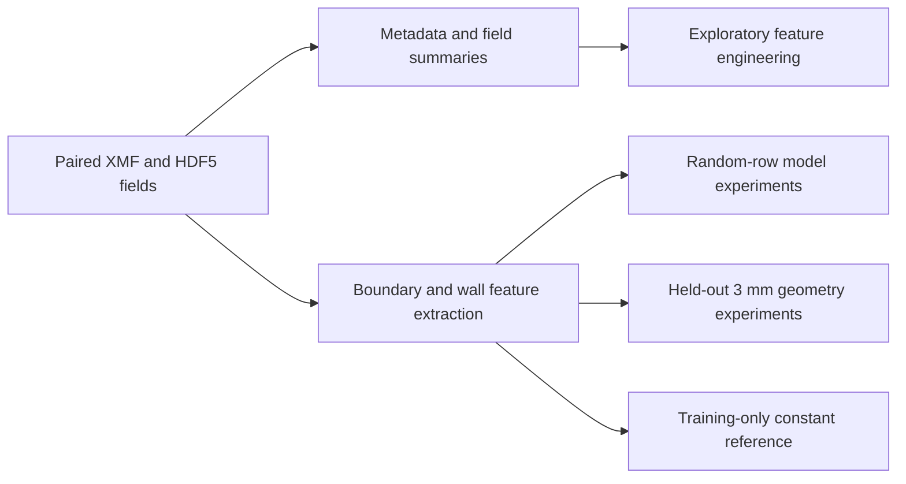

# Reverse Osmosis Spacer Research

CFD data extraction, feature engineering and machine learning experiments for reverse osmosis spacer analysis. The project studies pressure drop, concentration-polarization proxies and channel-velocity metrics across six spacer configurations, with spacing labels from 0.75 to 3 mm.

The recovered notebooks include XMF/HDF5 extraction, exploratory analysis, XGBoost, Random Forest, LightGBM, CatBoost, multi-output regression, a dense neural network and SHAP diagnostics. Both random-row splits and a held-out 3 mm geometry experiment are present.

**Research status:** exploratory experiments with preserved historical results. Notebook code has been reviewed, but the original model runs have not been independently reproduced. A new training-only constant baseline is executable without third-party packages. Physical assumptions, independent simulation groups, source permissions and model generalization need further validation.

## Start here

1. Read the [research overview](docs/RESEARCH_OVERVIEW.md) and [notebook catalogue](notebooks/README.md).
2. Follow the [reproduction guide](docs/REPRODUCIBILITY.md) for setup, working-directory rules and the independent baseline.
3. Review [code findings](docs/CODE_REVIEW.md), [historical results](docs/HISTORICAL_RESULTS.md) and [limitations](docs/LIMITATIONS.md) before reporting performance.
4. Use the [GitHub checklist](docs/GITHUB_PREPARATION.md) before publication.

## Layout

```text
notebooks/01_preprocessing/   Plant-data exploration and HDF5 dataset statistics
notebooks/02_extraction/     Metadata, raw fields, summaries and engineered features
notebooks/03_modeling/       Boundary feature extraction and model experiments
python_scripts/             Integrity tools, constant baseline and synthetic tests
RO_data/                    Original paired HDF5/XMF simulation hierarchy, local
data/tables/                Original CSV/XLSX inputs and derived tables, local
reports/figures/            Original exploratory figures
reports/baseline_reference/ Recorded aggregate constant-baseline results
reports/verification/       Integrity and code-preservation evidence
docs/                       Methods, provenance, review findings and manifests
archive/                    Exact recovered snapshots and earlier saved versions, local
```

The four full recovered notebooks remain at their original root paths as well as in `archive/recovered_originals/`. Their bytes are unchanged. The organized notebooks are review copies: all 94 cell positions are retained, review comments are added, and only `gem.ipynb` cell 25, with an explicit saved SHAP TypeError, is cleared. The complete source and output of that cell remain in the full recovered original. See the [cleanup log](docs/CLEANUP_LOG.md).

## Research workflow



This diagram maps the implementations found in the notebooks. It does not imply that every saved table has been regenerated or that every variant is physically validated.

## Quick checks

Python 3.12 and the standard library are sufficient:

```bash
python python_scripts/audit_research.py
python -m unittest discover -s python_scripts -p "test_*.py" -v
python python_scripts/baseline_geometry.py
```

The baseline requires the local `data/tables/Perfect_RO_Plant_Dataset2.xlsx`. It fits means and medians using configurations 1–5 and evaluates them on the exact `configuration6_interspacer3mm` label. These are reference predictions, not newly trained versions of the notebook models. [Aggregate metrics](reports/baseline_reference/metrics.json) record the data checksum and split.

For the complete local collection:

```bash
python python_scripts/audit_research.py --verify-originals
```

This also verifies the 2,558 originally saved files and all four recovered originals. A data-free clone runs the ordinary audit and synthetic tests; unavailable data checks are reported explicitly.

## Environment and data

Install `requirements-research.txt` in a clean virtual environment for notebook work. It reflects recovered imports rather than a validated historical lockfile. Original CSV/XLSX filenames are also available at the project root for path compatibility; unchanged authoritative copies are kept in `data/tables/`.

Data, root recovery copies, archives and training logs remain local under `.gitignore`. Confirm redistribution permissions before adding them. The five historical PNG figures are in the proposed tracked project and also need sharing permission. [Data catalogue](docs/DATA_CATALOG.md).

## Attribution

Authors, supervisor, affiliation, source citations and licenses require confirmation. No institutional relationship or deployment in Morocco is inferred from the historical folder name. No license or numerical performance claim has been invented.
